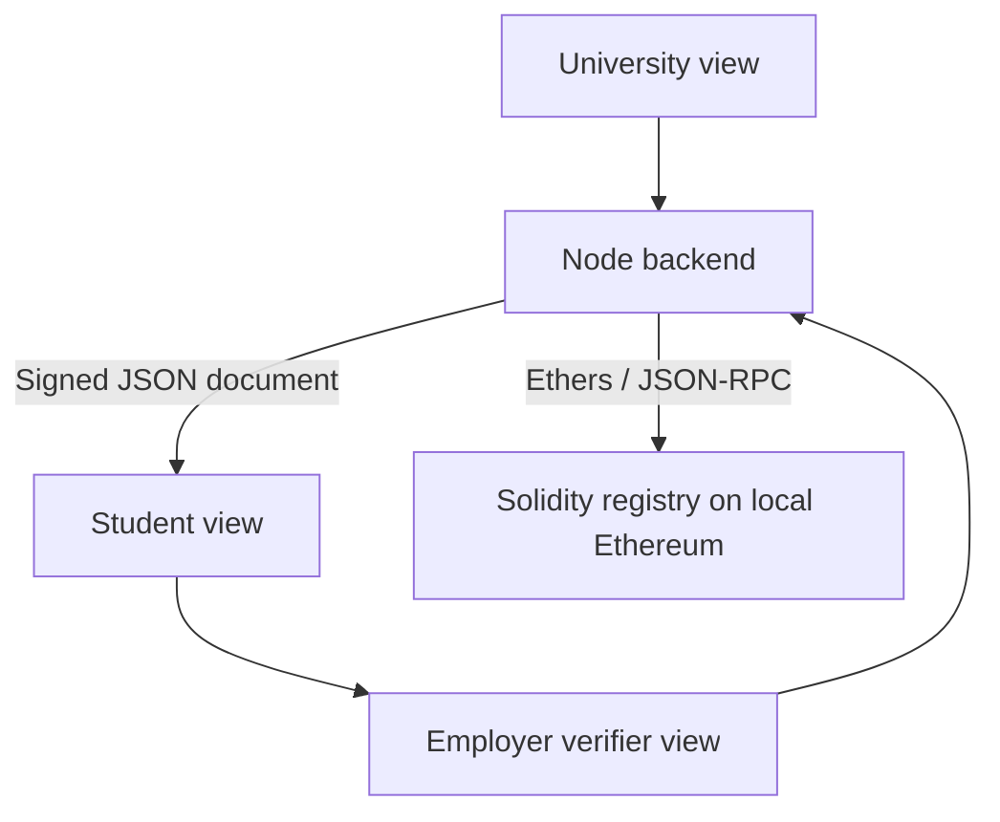

# CredChain architecture

The exact submitted project title is **CredChain: A Decentralized Academic Credential Verification System**.

## Components

All views run in one local application. They represent stakeholder workflows, not independently hosted organizations. The complete signed JSON is held in browser local storage or downloaded as a file. No central credential-content database is required for this prototype.

## Identity and trust

Hardhat account 0 is the administrator, account 1 is the university, account 2 is the test student, and account 3 is an unapproved actor for negative tests. Ethereum accounts sign transactions, so `msg.sender` enforces the contract's permission checks. The application derives `did:pkh:eip155:<chainId>:<address>` strings from those accounts.

The administrator approves the university and its institution name. Real-world institution onboarding still has to happen outside the ledger. The Ethereum registry does not prove that an account genuinely belongs to a named university. Student browser authentication and proof of possession are future work, so merely selecting a view is never presented as a security boundary.

## Issuance

The backend builds a credential with a random ID, chain ID, institution, issuer address/DID, student address/DID/name, degree, and validity dates. Its canonical serializer sorts JSON keys and supports bounded educational data types. This serializer is versioned by the schema and is not a claimed RFC 8785 implementation.

The university signs that exact canonical string using Ethers `signMessage` (Ethereum personal-message/EIP-191 signing). The contract stores SHA-256 of the canonical credential along with metadata. The signature remains in the off-chain envelope. The contract's record identifier is SHA-256 of the random credential ID.

## Verification

The verifier validates the document schema, recovers the signing account, checks administrator approval of the institution, reads the record, compares the digest and issuer/student/expiry fields, checks the validity window, checks revocation, and checks the chain ID. A modified degree fails both the original signature and the document-integrity check. A revoked credential may still have a valid signature, but its current status makes it invalid.

The contract's `verifyCredential` covers registry validity. The backend additionally verifies the off-chain issuer signature and the full schema. This split is part of the design and should be explained in the recording.

## Revocation and events

Only the issuing university can revoke its own credential. Disabling an issuer prevents new issuance and invalidates current credentials under that issuer while it is disabled. The contract emits identity, approval, issuance, and revocation events. The website reads these logs and displays the real transaction hashes.

## Why use a blockchain?

Independently operated universities and verifiers could share a status registry without giving one employer ownership of the central database. This local demo shows the mechanism and trust boundaries; it does not establish that such a consortium already exists. A conventional signed-credential/status-service architecture is a reasonable alternative for a single institution. The final report should compare operational complexity, governance, privacy, and verification availability.
